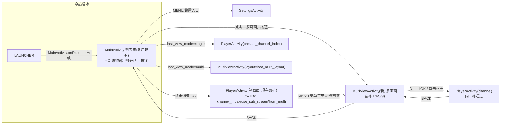
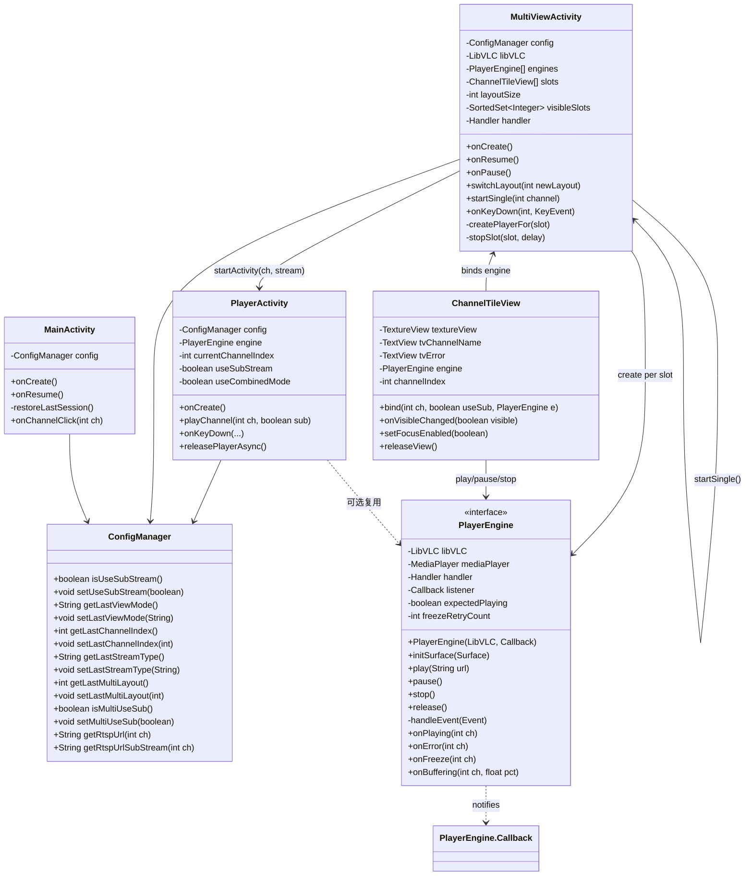
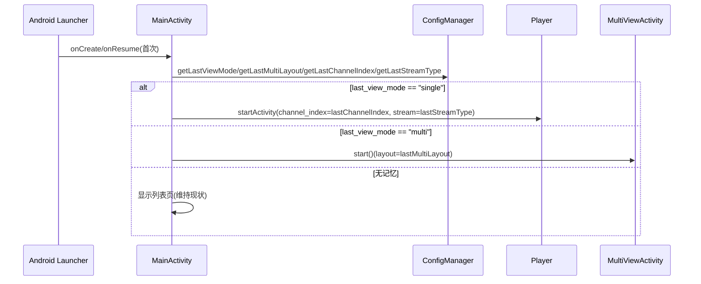
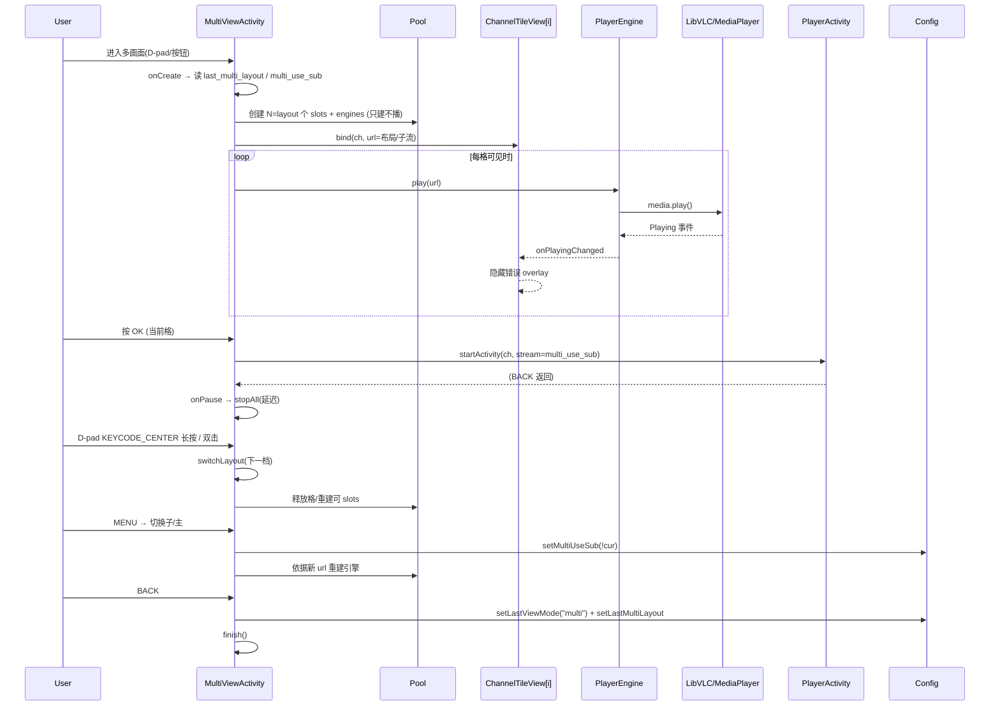
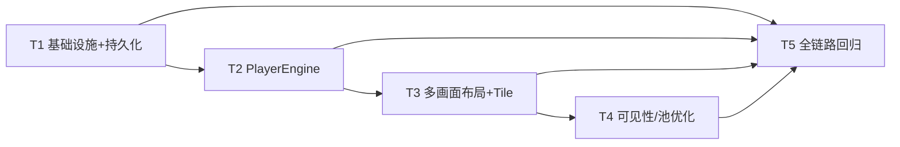

# 监看TV · 多画面宫格预览 + 记忆上次退出状态 实现方案（设计文档）

- 设计人：高见远（软件架构师）
- 项目：监测TV「app」package com.litevision.tv，minSdk 21 / targetSdk 33 / Java 17 / libVLC 3.5.1 / RecyclerView + AppCompat
- 范围：**仅设计**，不实现代码、不改动应用源码
- 配套文件：`docs/class-diagram.mermaid`、`docs/sequence-diagram.mermaid`

---

## 1. 方案概览（一段）

在不重构已验证稳定的单画面路径的前提下，**新增独立 `MultiViewActivity`（多画面宫格页）**，与现有 `PlayerActivity` 通过**可复用引擎 + 参数协议**打通：把单画面里"建 URL → 播放 → 事件处理 → 超时/冻结恢复 → 释放"抽成 `PlayerEngine`，把"单路纹理 + 通道名 + 错误状态"抽成 `ChannelTileView`；多画面页使用 **一个 LibVLC 实例 + 一个可伸缩的 MediaPlayer 池**（按 1/4/6/9 布局扩容，硬上限 9），采用"**仅有序可审判格才播放，不可见/离焦格延迟 2s 断开**"的可见性策略，控制 NVR 连接数和 CPU；多画面**默认子码流**（独立键 `multi_use_sub`，可切主码流并记忆）；在 `ConfigManager` 新增 `last_view_mode / last_channel_index / last_stream_type / last_multi_layout / multi_use_sub` 五个键，`MainActivity` 冷/热启动按键恢复"上次单/多画面 + 通道 + 码流 + 布局"。所有新交互（遥控 D-pad / 触屏手势）沿用现有 Player 的键位与手势语义，侵入面小。

---

## 2. 页面 / 路由设计

### 2.1 决策表

| 方案 | 结论 | 理由 |
|---|---|---|
| 改造 MainActivity 支持多画面 | ❌ 不采用 | 主页承担"列表 + 缩略图 + 设置入口"，多画面是"全屏多路解码 + 手势编排"，生命周期/资源/焦点模型完全不同，混在一起会让主页常驻媒体线程、状态爆炸 |
| 新增 `MultiViewActivity` 独立页，`PlayerActivity` 仅微改参数与状态 | ✅ 采用 | 职责分离、生命周期干净（onStop 全释放）、与 Player 平级、可独立测试 |

### 2.2 最终路由结构图



路由要点：
- `MainActivity` 首页判断恢复（onCreate 后**第一次** onResume，`restoredThisLaunch` 一次性标志）→ 按 `last_view_mode` 直达 Player 或 Multi；否则停留列表；
- Multi → Player（全屏单画面）是标准 `startActivity`（如下文第 4 节）；Player BACK 回到 Multi（Multi 还在回退栈）；
- `PlayerActivity` `configChanges` 已有 `smallestScreenSize|screenLayout`，Multi 注册同款，旋转不重建；
- `MultiViewActivity` manifest：

```xml
<activity
    android:name=".MultiViewActivity"
    android:exported="false"
    android:configChanges="screenSize|orientation|keyboardHidden|smallestScreenSize|screenLayout"
    android:screenOrientation="landscape" />
```

---

## 3. 多 MediaPlayer 生命周期与可见性策略

### 3.1 实例选型：单 LibVLC + N 个 MediaPlayer

| 方案 | 结论 |
|---|---|
| 每格一个 LibVLC 实例 | ❌ 爆内存（core 线程/解码器/缓存/网络栈 × 9），不可行 |
| **一个 LibVLC + N 个 MediaPlayer（官方支持多 MediaPlayer 共实例）** | ✅ 采用；每个 MP 独立解码线程，网络/缓存选项在实例级统一，如 `--rtsp-tcp --network-caching=3000 --avcodec-threads=4 --vout=android-display --no-audio`（**实例级 `--no-audio`：多画面所有格静音**） |

### 3.2 MP 池设计与生命周期

- `MultiViewActivity` 持有 `MediaPlayer[] pool`（容量随布局 = max(4, layout)，硬上限 9）+ `ChannelTileView[] slots` + `PlayerEngine[] engines`（引擎与 slot 一一对应，引擎持有 `MediaPlayer`）；
- **创建**：布局变化/进入时 `createPlayerFor(slot)`：`new MediaPlayer(libVLC)` → 设置 listener → `getVLCVout().setVideoSurface(tile.surface)` → `attachViews`（与 PlayerActivity `createVideoPlayer()` 同一套流程）；
- **播放**：`play(slot)` = `engine.setMedia(url) + play()`；url 由 `multi_use_sub` 决定 `getRtspUrlSubStream(idx)` 或 `getRtspUrl(idx)`；
- **暂停/释放**：
  - 暂时离开（切到别的 activity、焦点移出可见区）：延迟 2s 后 `stopSlot(slot)`：`mp.stop()` → `detachViews()` → `mp = null`（释放 SMP 资源与 NVR 连接），保持 `Media` 与 `LibVLC` 不释放（以便快速重建）；
  - 布局切换 / onStop / onDestroy：全量 `stopAll` 并 `libVLC.release()`（释放全部引擎）；
- **阻塞保护**：所有 `stop/release` 放后台线程（`vlc-stop` / `vlc-release`），与 PlayerActivity `releasePlayerAsync()` 防死锁一致；
- **计数**：动态布局 4→6→9 时**先停止多余 slots 再扩容**，避免瞬间 double 占用：
  - `switchLayout(new)`: 对 index ≥ new 的 slot `stopSlot`（释放 surface），随后调整 grid 行/列；
  - 新增 slot 创建 `MediaPlayer` 时**只建不播**，进入可见后再 `start`。

### 3.3 可见性策略（关键：NVR 连接数 / CPU / 内存）

| 布局 | 策略 |
|---|---|
| 1 | 唯一格全屏 start；无可见策略 |
| 4 | 4 格全 start |
| 6 | 6 格全 start |
| 9 | 默认 9 格全 start；**若现场 NVR 拒绝（连接数爆）或低端盒子卡顿 → 回退"仅焦点 2×2 区域 + 周边 1 圈 start，其余 stop"（实现为 P1）** |

判定机制：
1. `RecyclerView` 容器监听滚动与滚轴（`scrollListener` + `onFocusChange`）维护 `visibleSlots` 集合；
2. 焦点格 `slotFocused` 一定保证 `start`（保活）；
3. 某格从可见 → 不可见（滚动出屏 / 布局缩容）→ 调度 `stopSlot(slot, delay=2000ms)`（防抖，避免焦点抖动频繁启停）；
4. 某格从不可见 → 可见 → 立即 `start`（RTSP 子码流握手约 0.5~1s，可接受）；
5. `onWindowFocusChanged(false)` → 全部暂停；`onResume` → 重建可见格。

### 3.4 多画面 → 单画面全屏

- **采用方案 A：startActivity 进 PlayerActivity（P0）**——复用现有单播路径（含双 MP / combined / 音频 / 手势），传 `channel_index`、`use_sub_stream`（取当前 `multi_use_sub`）、`from_multi=true`；
- 可选方案 B（Multi 内部 1 格全屏）侵入大、不首期做（P2）。

---

## 4. 代码复用设计

### 4.1 抽出的可复用单元（在 `com.litevision.tv` 下）

1. **`PlayerEngine`**（单 MP 完整生命周期封装）：
   - 字段：`Lib`（实例，**由 MultiView/Player 各自初始化 libVLC 并注入**）、`MediaPlayer`、`expectedPlaying`、`mFreezeRetryCount`、回调 `Callback.onPlaying(onError/onFreeze/onBuffering)`；
   - 方法：`init(url)` / `play()` / `pause()` / `stop()` / `release()` / `setVideoSurface(Surface)`；
   - 内嵌：连接超时、冻结检测（`FREEZE_THRESHOLD_MS=6000`，重试≤2）、主→子自动降级（**从 PlayerActivity 原样迁移**）；
   - **不绑定 Activity**（只代理 Context + 回调），单画面与多画面共用。
2. **`ChannelTileView`**（格子视图组件）：
   - 组合：`TextureView`（视频） + `TextView`（通道名 overlay）+ `TextView`（错误/缓冲 overlay）；
   - 方法：`bind(int channel, boolean useSub, PlayerEngine engine)` / `onVisibleChanged(boolean)` / `showError(String)` / `releaseView()`；
   - 在 Multi 中每格一个；可选在 Player 中替换原单纹理（**不强制**，避免回归）。
3. **`MediaPoolManager`**（可选，P1）：
   - 若 Multi 与 Player 都要池化多路，可用；首版 Multi 自带一个简单池方法封装，不先推广。

### 4.2 对现有文件的侵入度（最小化）

| 文件 | 改动 | 侵入 |
|---|---|---|
| `ConfigManager.java` | 新增 5 个 KEY + get/set（§5） | 小（+约 60 行） |
| `MainActivity.java` | 顶部加「多画面」按钮；onCreate 后首次 onResume 执行恢复路由；onChannelClick 写 last_* | 小 |
| `PlayerActivity.java` | onCreate 读取 `EXTRA_use_sub_stream / EXTRA_from_multi`；onStop 写 `last_view_mode=single + last_channel_index`；`ChannelTileView` 不强制使用 | 极小 |
| `AndroidManifest.xml` | 新增 MultiViewActivity | 1 行级 |
| `ChannelAdapter.java` / `SettingsActivity.java` | **不改 / 不改（多画面子码流独立键，避免改动设置页）** | — |

**多画面复用 Player 引擎但关闭音频**：Multi 用 `--no-audio` 实例级（所有格无声），避免 9 路 PCM 同时输出；音频只在「单画面 Player」保留现有双 MP/combined 方案。若后续需「当前格音频」（P1 增强），为焦点格单独建 `AudioEngine`（Android MediaPlayer 或第二带音频 LibVLC 实例），不打断大方案。

---

## 5. 持久化 Schema（SharedPreferences，全部新增）

`ConfigManager`（`litevision_config`）统一维护，与现有 `use_sub_stream` 平级；**多画面与单画面码流键分离**。

| Key | 类型 | 默认值 | 写入时机 | 读取时机 | 行为 |
|---|---|---|---|---|---|
| `last_view_mode` | String | `null` | MultiView/Player 用户退出（onStop）时写 `"single"` / `"multi"` | Main onCreate 后首次 onResume | 首页恢复去向；null=不恢复 |
| `last_channel_index` | int | `0` | Player 退出/切台时写；Multi 某格 → 全屏时写 | Main 恢复 Player 时 | 上次单画面通道 |
| `last_stream_type` | String | `"auto"` | Player 退出、Multi 切子/主时写 `"sub"`/`"main"`/`"auto"` | Player/Multi 启动 | 码流偏好；`auto`=回退 `use_sub_stream` |
| `last_multi_layout` | int | `4` | Multi 切换布局时写 | Main 恢复 Multi；Multi 启动 | 1/4/6/9 |
| `multi_use_sub` | boolean | `true` | Multi 切换子/主时写 | Multi 每格创建 URL 时 | **多画面强制默认子码流**（独立于单画面 `use_sub_stream`） |

恢复流程实现位置：**MainActivity**（唯一
恢复逻辑：
```
MainActivity.onResume(首次):
  mode = config.getLastViewMode()
  if "single"  → startActivity(Player, ch=lastChannelIndex, stream=lastStreamType)
  if "multi"   → startActivity(Multi, layout=lastMultiLayout)
  else         → 正常列表
```
- 单画面退出：`PlayerActivity.onStop` 写 `last_view_mode=single` + `last_channel_index` + `last_stream_type`；
- 多画面退出：`MultiViewActivity.onStop` 写 `last_view_mode=multi` + `last_multi_layout`；
- 多画面「切子/主」写 `multi_use_sub`；切布局写 `last_multi_layout`（即时保存）。

---

## 6. 按键与触摸映射表

### 6.1 遥控 / D-pad

| 键 | PlayerActivity（现有） | MultiViewActivity（新） |
|---|---|---|
| DPAD_UP/DOWN/LEFT/RIGHT | 上/下/前/后通道 | 网格内移动焦点（左右/上下相邻格） |
| DPAD_CENTER / ENTER（短按） | 显示/隐藏通道信息 / 重试 | 进入全屏：当前格 → PlayerActivity(该通道) |
| DPAD_CENTER（长按≥800ms） | 开关音频 | **切换布局** 1→4→6→9→1（Toast 提示） |
| MENU（短按） | 开关音频 | **切换子/主码流**（Toast + 记忆 `multi_use_sub`） |
| MENU（长按≥800ms） | 切换 双MP/combined | 返回 Main（同 Player 语义：无音频则仅提示）或 同左（暂不生效） |
| BACK | 退出 Player | 返回 Main（写入 last_* 记忆） |

### 6.2 触屏（手机/平板/车机，语义与 Player 一致）

| 手势 | PlayerActivity（现有） | MultiViewActivity（新） |
|---|---|---|
| 单击 | 显隐 overlay | 选中格子 + 显示/隐藏该格通道名 |
| 双击 | 播放/暂停 | **切换布局**（1→4→6→9） |
| 左右滑动 | 上/下一个通道 | Multi: 翻页（layout 固定时滚动下一组通道组） |
| 上下滑动 | 音量 +- | 音量 +-（无音频时保留）+ 或当前格切主/子（可配置） |

> 触屏与遥控互斥：`isTouchScreenDevice()` 为 true 才绑 GestureDetector，否则全走 D-pad（同现有 Player 逻辑）。

---

## 7. 文件清单

- 新增：
  - `app/src/main/java/com/litevision/tv/MultiViewActivity.java`
  - `app/src/main/java/com/litevision/tv/PlayerEngine.java`
  - `app/src/main/java/com/litevision/tv/ChannelTileView.java`
  - `app/src/main/res/layout/activity_multi.xml`
  - `app/src/main/res/layout/item_tile_channel.xml`（格子 item）
- 修改：
  - `app/src/main/java/com/litevision/tv/ConfigManager.java`（5 个新键 + get/set）
  - `app/src/main/java/com/litevision/tv/MainActivity.java`（入口按钮 + 首次 onResume 恢复路由 + 写状态）
  - `app/src/main/java/com/litevision/tv/PlayerActivity.java`（读 EXTRA + 写状态；可选改用 `PlayerEngine`）
  - `app/src/main/AndroidManifest.xml`（注册 MultiViewActivity）
  - `app/src/main/res/layout/activity_main.xml`（增加「多画面」按钮）
  - `app/src/main/res/values/strings.xml`（多画面/布局/码流相关文案）
- 不改：`ChannelAdapter.java`、`SettingsActivity.java`、`NvrClient.java`、`ThumbnailLoader.java`

---

## 8. 数据结构与接口（Class Diagram）



---

## 9. 程序调用流程（Sequence Diagram）

### 9.1 冷/热启动状态恢复



### 9.2 多画面运行流程



### 9.3 单画面接入多画面

```mermaid
sequenceDiagram
    participant User
    participant Multi
    participant Player
    participant Config

    User->>Multi: 格子 OK / 单击
    Multi->>Config: setLastChannelIndex(ch); setLastStreamType(multi_use_sub?"sub":"main")
    Multi->>Player: startActivity(ch, from_multi=true, stream=...)
    Player->>Player: onCreate 读 EXTRA → playChannel(ch, sub)
    User->>Player: BACK / 退出
    Player->>Multi: 回退到 Multi (栈内)
    Player->>Config: 保存 last_channel_index
```

---

## 10. 任务列表（有序、依赖、验收）

> 共 **5 个任务**（≤5 硬性上限），按模块分组，首个任务为基础设施；实现顺序与依赖见 §12 图。

### T01 项目基础设施与状态持久化（P0）

- **文件**：`ConfigManager.java`（新增键 + get/set）、`MainActivity.java`（多画面入口按钮 + 首次 onResume 恢复路由 + onChannelClick 写状态）、`PlayerActivity.java`（EXTRA 读取 + onStop 保存 last_*）、`AndroidManifest.xml`、`activity_main.xml`、`strings.xml`
- **依赖**：无
- **验收**：
  - 冷启动（杀进程）：`last_view_mode=single` → 直进 Player 对应频道；`=multi` → 直进 Multi 对应布局；无键 → 正常列表；
  - Main 列表出现「多画面」按钮；Player 退出保存索引与 mode；
  - 五个新 key 读写一致（可加日志断言）。

### T2 LibVLC 引擎封装 PlayerEngine（P0）

- **文件**：`PlayerEngine.java`（新）、`PlayerActivity.java`（play/videoStop/freeze/超时逻辑替换为 engine 调用）
- **依赖**：T1
- **验收**：单独播放/切台/超时/冻结恢复/主子降级行为与现状**完全一致**（人工播放回归清单）；不解体双 MP 音频路径。

### T3 多画面布局 + ChannelTileView（P0）

- **文件**：`ChannelTileView.java`（新）、`MultiViewActivity.java`（新：1/4/6/9 切换、池创建、D-pad/触屏映射）、`activity_multi.xml`、`item_tile_channel.xml`、`strings.xml`
- **依赖**：T2
- **验收**：
  - 1/4/6/9 用 D-pad 长按 center 与连接（触屏双击）可切；
  - 每格显示通道名 + 实时画面；焦点移动正确；
  - OK → 进 Player 全屏；BACK → 返回且存参数。

### T4 可见性优化 + MP 池 + 性能（P1）

- **文件**：`MultiViewActivity.java`（延迟 2s stop + visibleSlots 维护 + layout 切换重建）、`PlayerEngine.java`（支持 stop 后 reuse）
- **依赖**：T3
- **验收**：
  - 9 格不出现连接爆掉/卡顿（如盒子上不行 → 回退「焦点格区域」策略见 §3.3）；
  - 布局切换 4↔6↔9 旧格 RTSP 断开、新格重建正常；长时间停留内存平稳增长 < 每 3 分钟 < 10MB；
  - 熄屏/切到后台 onStop 全释放。

### T5 全链路联调 + 恢复回归（P1）

- **文件**：`MainActivity.java`（恢复路由最终）+ `MultiViewActivity.java` + `PlayerActivity.java`（边界 fix）*
- **依赖**：T1-T4
- **验收**：
  - 验证「Main→Multi→全屏→返回 Multi→Main」「全屏→Multi」「冷启动→每个状态恢复」；
  - 真机过测：盒子×1、手机×1、平板×1（含 RK3128/S905X 较低端型号）；
  - 无崩溃回归，`adb logcat` 无 VLC STOP 泄漏/"Unable to release" 报错。

---

## 11. 所需依赖包

```
（无新增第三方依赖）
org.videolan.android:libvlc-all:3.5.1     # 已有，多画面沿用
androidx.appcompat:appcompat:1.6.1       # 已有
androidx.recyclerview:recyclerview:1.3.2 # 已有（多画面容器复用）
com.google.android.material:material:1.9.0 # 已有（可选，按钮样式）
```

---

## 12. 共享约定（Engineer 须知）

- RTSP URL 一律经 `ConfigManager.getRtspUrl(ch)` / `getRtspUrlSubStream(ch)` 获取（仅差码流号），多画面每格用 `multi_use_sub` 判定；
- 码流 KEY：单画面用现有 `use_sub_stream`；多画面用新 `last_multi_layout`/`multi_use_sub`，**不得混写**；
- 所有 `MediaPlayer.stop()/release()` 必须在后台线程（防死锁），`MediaPlayer.play()/事件回调` 回 UI/主线程；
- 多画面 `LibVLC` 实例化参数统一 `--rtsp-tcp --network-caching=3000 --avcodec-threads=4 --vout=android-display --no-audio`；
- 恢复流程只在 `MainActivity`（首次 onResume + `restoredOnce` 标志）执行；
- 手势：触屏设备才注册 GestureDetector；非触屏（TV）走 D-pad；两套不共存；
- 状态写盘时机：退出（onStop/onBack）/切换布局/切换码流时立即写。

---

## 13. 任务依赖图



---

## 14. 风险与取舍

| # | 风险 | 应对 |
|---|---|---|
| R1 | 海康每通道 RTSP 常限 1~2 连接，9 格可能占爆 → 单画面拉流失败 | 多画面默认子码流 + 不可见格 2s 断开 + 9 格回退「焦点格」策略；写入日志阈值（连接数 ≤16 告警） |
| R2 | 9 路解码对低端盒子 CPU/内存压力 | `--avcodec-threads=2`、`--rtsp-cache` 压缩；9 路默认全开但保留回退开关 |
| R3 | `--no-audio` 实例级 = 多画面全静音，用户想听某路 | 第一版接受；后续 P1「当前格 AudioEngine」（Android MediaPlayer 或第二 LibVLC 实例） |
| R4 | 多路同时超时/冻结/反复重连 | 引擎中每格独立冻结检测（阈值 6s、重试 2），最多 6 格并行，对 timeout Handler 不可共用；日志分级 |
| R5 | 触屏手势与 D-pad 场景并发 | 触屏设备绑定手势、TV 绑定 D-pad；互斥（与 Player 同） |
| R6 | 冷启动直进超屏幕闪屏 | Main 先 setContentView + 闪烁页 100ms 转场再 start（不黑屏） |
| R7 | 布局切换黑屏/重绑定 | 先释放旧 slot MP（detachViews）再创建新 MP；全部在重建 OnNewLayout 之前 |
| R8 | 多画面默认子码与 Settings 全局码流冲突 | 独立键 `multi_use_sub`，单画面仍用 `use_sub_use`，互不干扰 |

---

## 15. 未明确事项（假设）

1. 「点某格放大到单通道全屏」：本设计理解为进入独立 `PlayerActivity`（与点击列表卡片一致），而非 Multi 内就地 1 格扩屏；若需就地扩屏，请反馈 → 改为方案 B（P2）。
2. 多画面每格**默认只出视频、无音频**；如果期望「选中格有声音」，属 P1 增强点，需另行确认。
3. 记忆「下次启动自动回到该状态」：含义为**冷启动**直接恢复；若希望「上次状态只保留一次」（用户回到 Main 后清空），需在 Main 恢复后调用 `config.setLastViewMode(null)`。默认未清空（保持持久记忆），可后续提供开关。
4. 遥控器中「D 键右键无多画面入口」的快速进入方式，暂不含；入口统一为首页「多画面」按钮 + Player 退出场景。
5. 1/4/6/9 中的「9」在极低端盒子（RK3288 等级）上的表现待真机验证；如 NVR 连接限制，将自动落到「9 格只活跃区域」回退。